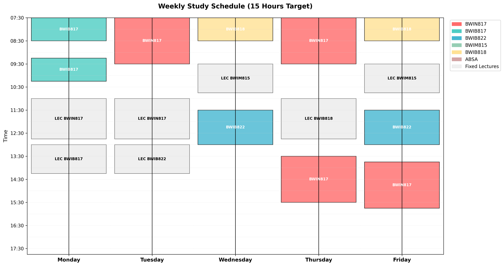

# Scheduler

A weekly study-timetable optimiser for BMI (Business Mathematics and Informatics) postgraduate students at North-West University. You give it your fixed lectures and how many self-study sessions each module needs. It then uses the CP-SAT constraint solver from Google OR-Tools to fit those sessions around your lectures, with breaks, in a Monday–Friday timetable.

It comes in two forms: a Streamlit web app (`app.py`), where you edit the inputs in tables, and a standalone script (`scheduler.py`), where the inputs are set in code.

## Example output



`bmi_weekly_timetable.png` is the timetable that `scheduler.py` produces with its default settings. These are a 15-hour weekly target, the default MSc lecture timetable (grey blocks) and self-study sessions for BWIN817, BWIB817, BWIB822 and BWIB818.

## Features

- **Fixed lectures:** lectures are blocked out, and study sessions keep a buffer before and after each one (45 min by default).
- **Session rules per module:** each module has a minimum and maximum number of sessions of a set length. For example, BWIN817 gets 2–4 sessions of 120 minutes.
- **Breaks:** any two study sessions on the same day are at least a minimum break apart (45 min by default).
- **Weekly target:** total scheduled study time must reach the target (15 hours by default).
- **Study day:** every session falls inside the study day (07:30–17:45 by default).
- **Earliest start:** of the valid timetables, the solver prefers the one whose sessions start earliest in the day. Each solve is limited to 10 seconds.
- **Web app only:** you can add assignments with a start day, a due day and a number of hours. Each assignment is split into 1-hour blocks, and every block is scheduled between those days. Assignment hours count towards the weekly target. The app shows the timetable and a table of sessions, and lets you download the schedule as `optimized_schedule.csv`.
- **Script only:** the script prints the schedule to the console and saves the timetable image. It also has an optional Friday 08:30–10:30 "ABSA" block that study sessions avoid. To turn it on, put any value in `absa_dates`.

## Tech stack

- Python
- [Google OR-Tools](https://developers.google.com/optimization) (CP-SAT solver)
- Streamlit (web app)
- pandas, NumPy, matplotlib

## Project structure

```
.
├── app.py                    # Streamlit app: edit lectures, study needs and assignments, then solve
├── scheduler.py              # Standalone script with the default timetable hard-coded; saves the PNG
├── bmi_weekly_timetable.png  # Example output from scheduler.py
└── requirements.txt          # Python dependencies
```

## Getting started

You need Python 3.

```bash
git clone https://github.com/TafaraBean/scheduler.git
cd scheduler
python -m venv .venv
source .venv/bin/activate        # Windows: .venv\Scripts\activate
pip install -r requirements.txt
```

### Web app

```bash
streamlit run app.py
```

Streamlit opens the app in your browser. Follow these steps:

1. Set the weekly target, minimum break, class buffer and day start/end in the sidebar.
2. Edit the **Fixed Lectures**, **Self-Study Requirements** and **Assignments & Deadlines** tables. Enter times as `HH:MM`. You can add and delete rows, and rows with an empty cell are ignored.
3. Click **Generate Optimal Schedule**.

### Script

```bash
python scheduler.py
```

The script prints the schedule and saves `bmi_weekly_timetable.png` in the current folder, overwriting the example image. To change the inputs, edit these parts of `scheduler.py`:

- `StudyScheduler.__init__`: target hours, day start and end, break and buffer lengths
- `_get_fixed_modules()`: the lectures
- `_define_study_sessions()`: one line per module, giving the module, minimum sessions, maximum sessions and minutes per session

The script also runs in Google Colab if you install `ortools` in the notebook first.

## Notes and limitations

- The plan covers one generic Monday–Friday week. It has no calendar dates and no weekend days.
- In the app, an assignment whose Start Day is after its Due Day gets no blocks on the timetable, but its hours still count towards the weekly target. The solver does not report an error in this case.
- In the app, a lecture time that is not in `HH:MM` format is read as 00:00. This can block out the whole morning or make the model invalid.
- In `scheduler.py`, the ABSA block applies to every Friday once it is turned on, because the dates in `absa_dates` are not used. The block is also not drawn on the timetable, although "ABSA" appears in the legend.
- `app.py` uses `width="stretch"` on Streamlit widgets, so it needs a recent Streamlit release.
